# Ledger — Dashboard bancário Angular


> Transformar dados bancários em UX: saldo, timeline de transações, charts e dark mode.
> Pilar **Dashboard** · Semana 3 do roadmap · Milestone `m1-ledger` · Demo pública no GitHub Pages.

---

## Screenshots do Produto

### Login (modo demo)
| Desktop | Mobile |
|---------|--------|
| 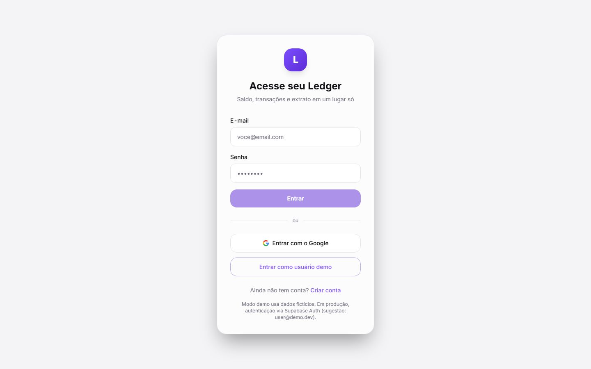 |  |

### Cadastro (dados, 2FA e biometria)
| Desktop | Mobile |
|---------|--------|
| 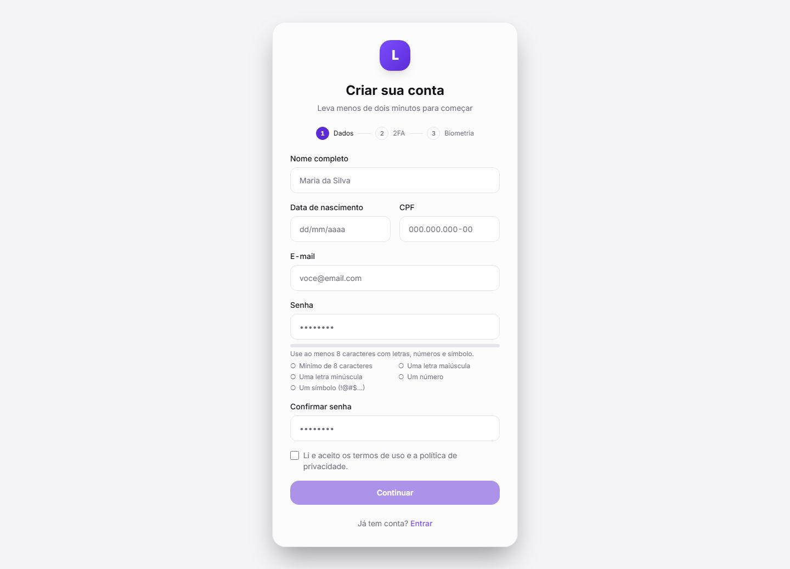 | 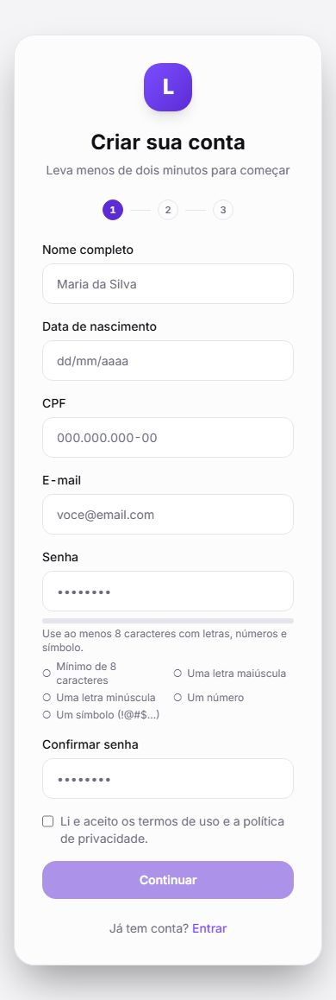 |

### Dashboard
| Desktop | Mobile |
|---------|--------|
| 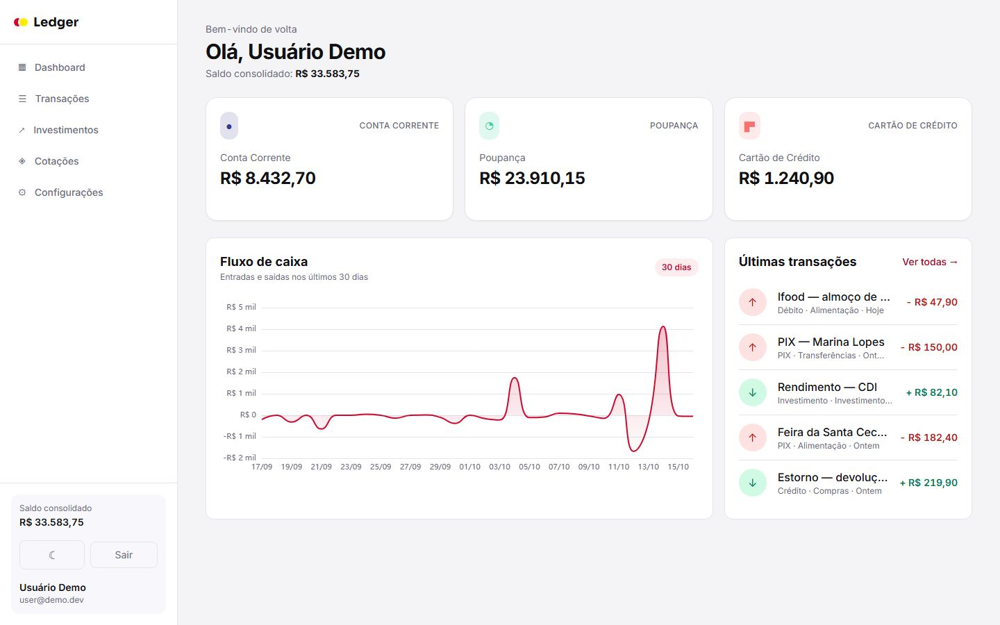 | 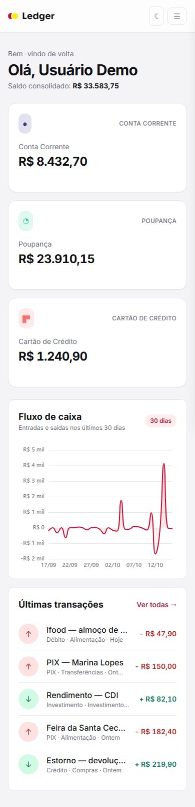 |

### Transações
| Desktop | Mobile |
|---------|--------|
| 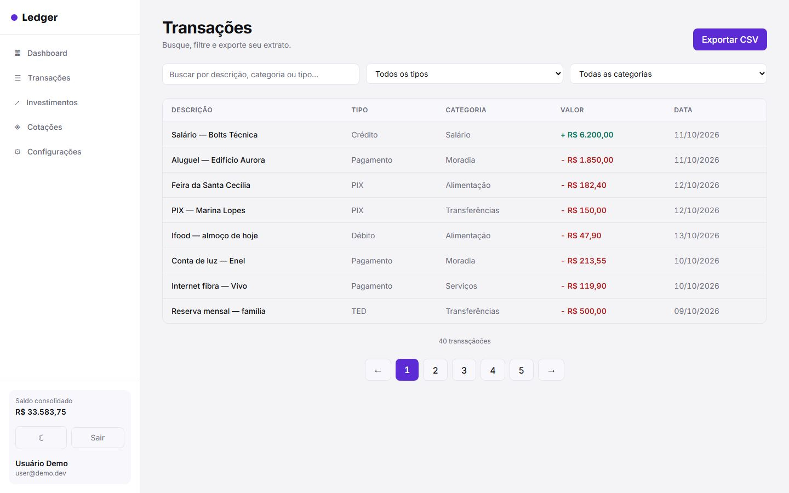 | 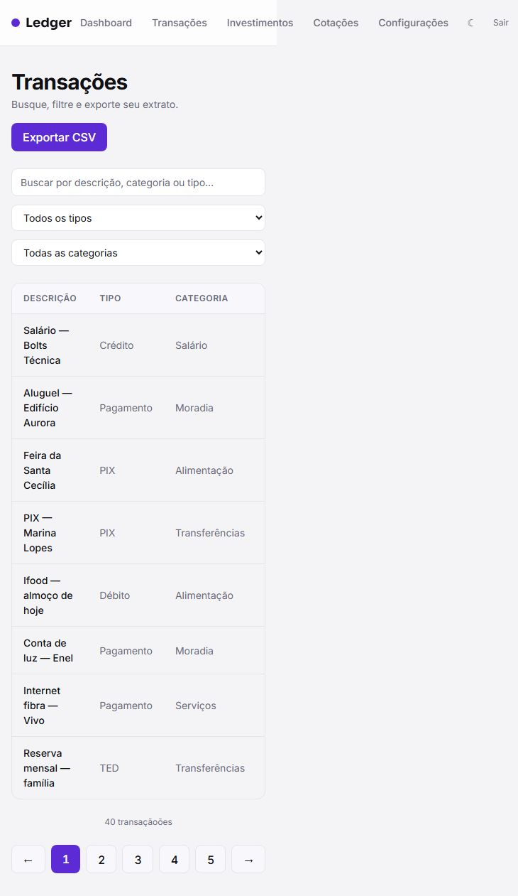 |

### Extrato da conta
| Desktop | Mobile |
|---------|--------|
| 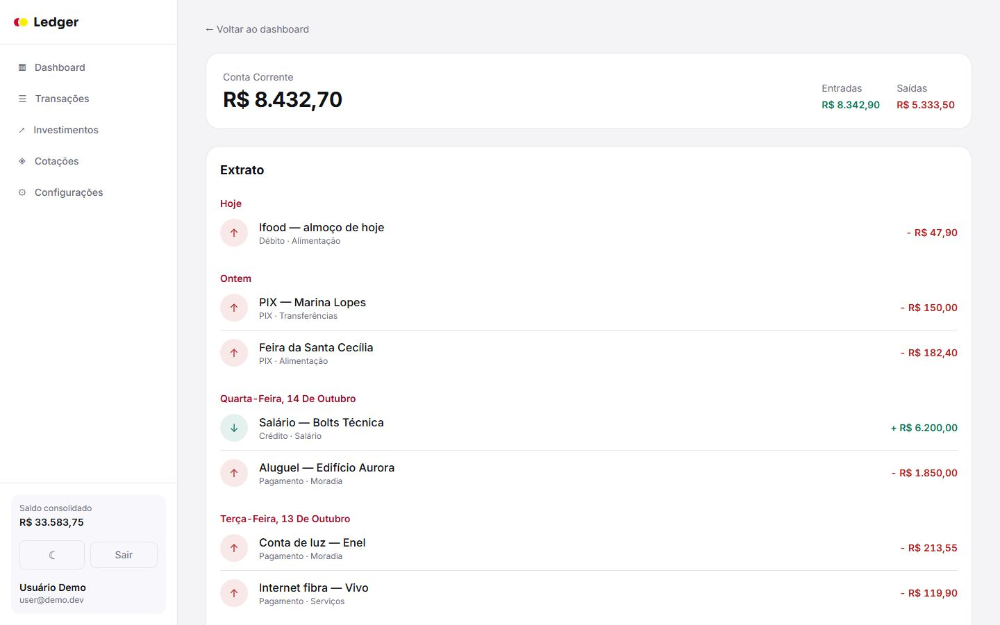 | 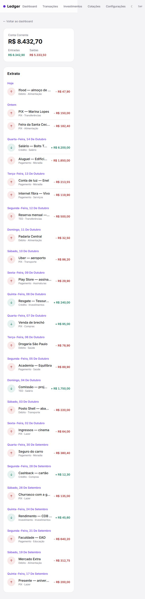 |

### Integrações — visão geral
| Desktop | Mobile |
|---------|--------|
| 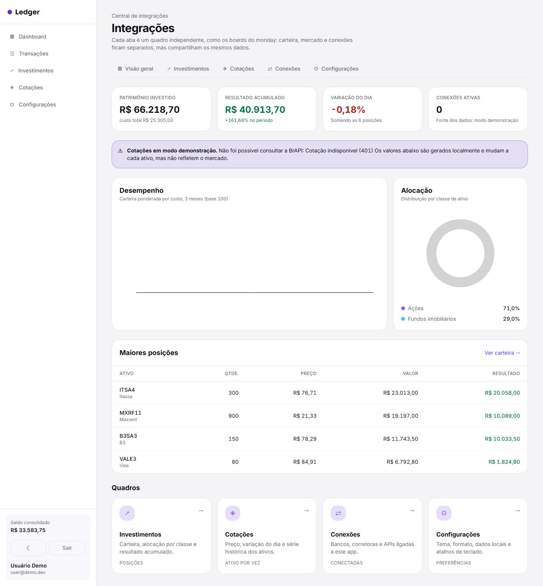 | 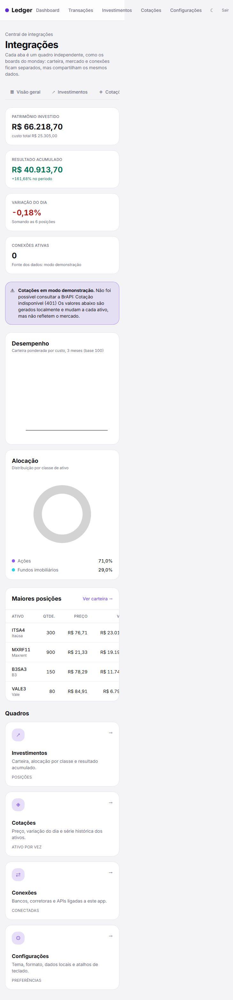 |

### Cotações
| Desktop | Mobile |
|---------|--------|
| 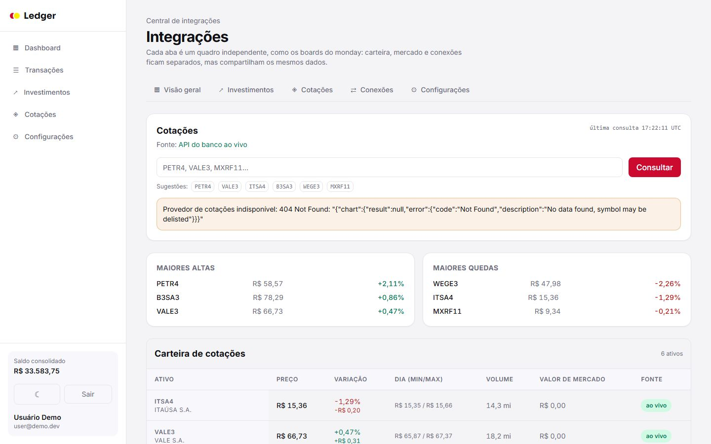 | 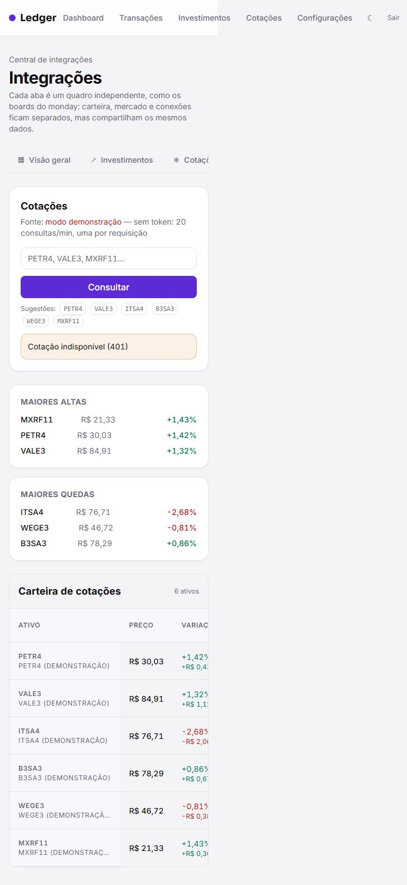 |

> **Baselines:** screenshots de 7 telas × desktop/mobile versionadas em `docs/screenshots/`, geradas por `e2e/screenshots.spec.ts` (Playwright), já autenticadas no login demo. Regerar com `npm run e2e:screenshots`.

---

## Documentação

| Arquivo | Descrição |
|---------|-----------|
| [`docs/ledger-bank-case.md`](./docs/ledger-bank-case.md) | Case study: contexto, desafio, solução, métricas e "o que aprendi" |
| [`docs/a11y/relatorio-axe.json`](./docs/a11y/relatorio-axe.json) | Relatório de acessibilidade (axe) das 9 telas |
| [`docs/clarity-integracao.md`](./docs/clarity-integracao.md) | Integração do Microsoft Clarity (mapa de calor) |
| [`docs/manter-online.md`](./docs/manter-online.md) | Estratégia zero-standby (custo zero) |

---

## Setup Rápido

```bash
npm install          # instala dependências
npm start            # ng serve → http://localhost:4200
```

O app funciona **sem backend**: sem credenciais Supabase ele sobe em **modo demonstração**,
com um seed local de ~40 transações ancoradas em "hoje". O botão **"Entrar como usuário demo"**
na tela de login dá acesso imediato ao dashboard.

---

## Comandos Principais

| Comando | Descrição |
|---------|-----------|
| `npm start` | Servidor de desenvolvimento (`ng serve`) |
| `npm run build` | Build de produção (`ng build`) |
| `npm run lint` | ESLint + angular-eslint |
| `npm test` | Testes unitários (Vitest, watch) |
| `npm run test:ci` | Testes unitários + cobertura (CI) |
| `npm run e2e` | Playwright (smoke + integrações + axe + screenshots) |
| `npm run e2e:smoke` | Somente o smoke E2E (navegação, login demo, tema) |
| `npm run e2e:a11y` | Varredura de acessibilidade (gera relatório axe) |
| `npm run e2e:screenshots` | Regenera os prints do README |
| `npm run analyze` | Análise de bundle (`ng build --stats-json`) |

---

## Telas Implementadas

| Tela | Rota | Conteúdo |
|------|------|----------|
| Login | `/login` | Formulário por template + **login demo** + **Google**; erro com `role="alert"` |
| Cadastro | `/cadastro` | Fluxo em 3 passos: dados (nome, nascimento, CPF, senha forte) → **2FA/TOTP** → **biometria (WebAuthn)** |
| Dashboard | `/dashboard` | Saldo consolidado, cards de conta, gráfico de fluxo de caixa (ECharts) |
| Transações | `/transacoes` | Tabela com busca por descrição e paginação acessível (`aria-current`) |
| Investimentos | `/investimentos` | Posições, filtro por classe e série histórica por período |
| Cotações | `/cotacoes` | Busca de ticker (via API Java), maiores altas/quedas, origem do dado explícita |
| Configurações | `/configuracoes` | Tema claro/escuro, moeda de exibição, exportação CSV |
| Detalhe de conta | `/conta/:id` | Extrato agrupado por dia + resumo da conta |
| Integrações | `/integracoes` | Hub em **quadros (estilo monday)** com 5 abas lazy |

---

## Qualidade & Performance

| Métrica | Resultado |
|---------|-----------|
| **Unit tests (Vitest)** | 176/176 passando (22 arquivos) |
| **Cobertura** | 94,1% statements · 84,9% branches · 95,1% lines |
| **E2E (Playwright)** | 41/41 passando (smoke, integrações, axe, screenshots) |
| **Acessibilidade (axe)** | 0 violações graves/críticas nas 8 telas |
| **Lighthouse** | Performance **91** · A11y **100** · Best Practices **100** · SEO **100** |
| **ESLint** | 0 erros · 0 warnings |
| **Bundle inicial** | 308 kB (≈84 kB transfer) |
| **Responsivo** | mobile (390) / desktop (1440) |

> O orçamento de bundle em `angular.json` (350 kB warning / 450 kB erro) foi escolhido **a partir do tamanho real medido** — um limite abaixo do baseline do Angular só gera ruído no CI.

---

## Acessibilidade

Varredura automatizada com `@axe-core/playwright` (tags WCAG 2.0/2.1 A+AA) nas **8 telas** — **zero violações** graves ou críticas.

- Landmark `<main>` explícito e hierarquia de títulos coerente (`h1` único por tela).
- Gráficos com rótulo acessível (`aria-label`), tabelas com `caption`/`th scoped` e paginação com `aria-current`.
- Tema claro/escuro com contraste verificado nos dois modos; foco visível preservado.
- Relatório versionado em [`docs/a11y/relatorio-axe.json`](./docs/a11y/relatorio-axe.json). Reproduzir: `npm run e2e:a11y`.

---

## Design — decisão e intenção

> Cada escolha abaixo tem um "para quê" — nada é decorativo solto.

### Conceito

**Ledger** é um app fictício de finanças pessoais. O foco é a leitura rápida de números: saldo, fluxo e extrato em uma hierarquia que sobrevive a dados densos — sem "dashboard de blog". Escuro por padrão, contraste alto nos números.

### Tokens semânticos em `src/styles.css`

A paleta troca por **classe** (`.dark` no `<html>`), não por `prefers-color-scheme` — é o que permite o toggle manual persistido em `localStorage`.

```css
@theme  { --color-surface: var(--surface); ... }  /* gera as utilitárias */
:root  { --surface: #ffffff; }                    /* claro  */
.dark  { --surface: #14141b; }                    /* escuro */
```

Um script inline no `index.html` aplica a classe **antes da primeira pintura** (sem flash de tema). O ECharts desenha em canvas e não herda CSS: `chart-theme.ts` lê os mesmos tokens com `getComputedStyle` e o `Chart` reaplica a série quando o tema muda.

### Hub de Integrações (quadros no estilo monday)

A engrenagem no shell abre `/integracoes`, que não é um formulário de configurações e sim um **conjunto de quadros**, cada um lazy e com estado próprio:

| Aba | Rota | O que resolve |
|---|---|---|
| Visão geral | `/integracoes/visao-geral` | patrimônio, P&L, variação do dia, curva e alocação |
| Investimentos | `/integracoes/investimentos` | posições, filtro por classe, série histórica por período |
| Cotações | `/integracoes/cotacoes` | busca de ticker, maiores altas/quedas, tabela com origem do dado |
| Conexões | `/integracoes/conexoes` | quem está ligado, o que exige login, o que vem do ambiente |
| Configurações | `/integracoes/configuracoes` | tema, moeda, exportação CSV, atalhos |

A pasta `features/integrations/` tem um componente por quadro e a rota pai só cuida das abas + `<router-outlet>`.

### Cotações: API Java

O navegador **não** chama fonte externa de cotação. Quem fala com o mercado é a API Java do banco (`/api/mercado/cotacoes` e `/api/mercado/series`), e o `MarketService` só consome esses dois endpoints:

1. **Sem token no frontend** — nenhuma credencial de terceiro chega ao navegador; a integração e a chave ficam no servidor.
2. **Sem problema de CORS** — o Java resolve a origem, o app só fala com a própria API.
3. **Lote de verdade** — o Java busca vários tickers numa requisição só e mantém cache de 60 s; não existe mais fila serial nem o limite de 20 req/min no cliente.

**O app nunca mostra número inventado como se fosse de mercado.** Toda `QuoteResult` carrega `origin: 'ao_vivo' | 'cache' | 'demo'`, exibido como tag. Quando a API responde `success:false` ou a rede cai, o serviço usa um seed determinístico (o mesmo ticker sempre gera o mesmo preço) e a tela avisa que está em modo demonstração.

---

## Arquitetura

```text
src/app/
├─ core/                 # singletons: sem UI, sem rota
│  ├─ echarts.ts         # registro modular do ECharts (linha, barra, rosca)
│  ├─ guards/            # authGuard
│  ├─ services/          # AuthService · LedgerDataService · ThemeService
│  │                     # MarketService · PortfolioService · IntegrationsService
│  ├─ utils/             # format (BRL, datas, filtro, CSV, mercado) · chart-theme
│  └─ models.ts
├─ features/             # lazy por rota, uma pasta por página
│  ├─ login/  dashboard/  transactions/  account/
│  └─ integrations/      # layout + 5 quadros
└─ shared/components/    # shell · balance-card · chart · transaction-list · pagination
e2e/                     # Playwright: smoke, integrações, acessibilidade (axe), screenshots
docs/                    # case study, a11y, screenshots, runbooks
.github/workflows/       # CI (lint→build→unit→e2e→lighthouse) + Deploy (GitHub Pages)
```

- **Guard no pai das rotas protegidas** (`canActivate` em `path: ''`): uma regra só, e `login` fica fora dela.
- **`withComponentInputBinding()`** liga o `:id` da rota direto no `input()` do `AccountDetailPage` — sem subscribe manual de `ActivatedRoute`.
- **Supabase lazy**: o SDK não é tree-shakável, então `supabase-client.ts` faz `import()` dinâmico — só baixa quando há credencial. O modo demo não usa backend.

---

## Decisão de teste: Vitest

Vitest em vez de Karma por três motivos concretos: o builder `@angular/build:unit-test` do Angular 22 já roda Vitest nativamente (zero adapter — `ng test` e a CI usam o mesmo caminho); `vi.mock` intercepta o `import()` dinâmico do Supabase, deixando o ramo "com credenciais" testável de verdade; e a saída é compatível com o `@vitest/coverage-v8` já usado.

> Cada repo do roadmap alterna Karma/Vitest de propósito: agnóstico de ferramenta, escolha por contexto.

---

## Stack

| Responsabilidade | Tecnologia |
|------------------|------------|
| Framework | Angular 22 (standalone, signals, zoneless, OnPush) |
| Linguagem | TypeScript |
| Estilização | Tailwind CSS 4 |
| Gráficos | ECharts (registro modular) |
| Backend/Dados | Supabase (Postgres + Auth + RLS) com fallback demo · API Java para cotações |
| Testes | Vitest (unit) · Playwright + axe (E2E/a11y) |
| Qualidade | ESLint + angular-eslint · Lighthouse CI |
| Deploy | GitHub Pages (site estático) |

---

## Branches & Workflow Git

```text
main      → produção (build estático; push dispara deploy no GitHub Pages)
homolog   → validação/release de PRs (staging)
develop   → integração diária (merges das feat/*)
feature   → feat/<assunto> + PR para develop
```

- **Commits:** `feat:`, `fix:`, `test:`, `docs:`, `design:`, `ops:`, `backend:` (Conventional Commits)
- **PRs:** via pull request template; revisados e mergeados por milestone
- **main:** protegida — merge somente via PR
- Rastreabilidade com issues, labels (`feat/test/design/ops/backend`) e milestones

---

## Bots (estação local + CI)

Os bots vivem em `bots/` e rodam localmente e no GitHub Actions.

| Bot | O que faz | Como roda localmente |
|-----|-----------|----------------------|
| **Humano** (`bots/humano/navegacao-humana.mjs`) | Navega com comportamento de pessoa real (cliques com atraso, scroll gradual, hesitação). Detecta travamento e navegação quebrada. | `BOT_URL=http://localhost:4200 node bots/humano/navegacao-humana.mjs` |
| **Analisador de erros** (`bots/analise-erros/analisador.mjs`) | Lê logs de build/e2e/CI, classifica por severidade e aponta padrões repetidos. | `node bots/analise-erros/analisador.mjs` |
| **CI + Lighthouse** | `npm ci` → lint → build → Vitest (coverage) → Playwright + axe → Lighthouse. | `npm run build` + `npx lhci autorun` |

---

## Microsoft Clarity (mapa de calor)

Integração **condicional**: o snippet só é ativado quando a variável `CLARITY_PROJECT_ID` estiver definida. Grava mapa de calor, scroll, cliques e sessões reais. Ver [`docs/clarity-integracao.md`](./docs/clarity-integracao.md).

---

## Deploy

- **GitHub Pages** (projeto público): `https://zecki1.github.io/angular-ledger-bank/`
  Workflow [`.github/workflows/deploy-pages.yaml`](./.github/workflows/deploy-pages.yaml) — build com `--base-href=/angular-ledger-bank/` + fallback SPA (`index.html` → `404.html`).
- **Política do workspace:** projetos públicos → GitHub Pages; projetos privados → Vercel.
- Estratégia zero-standby documentada em [`docs/manter-online.md`](./docs/manter-online.md).

---

## Links Úteis

- **Produção (GitHub Pages):** https://zecki1.github.io/angular-ledger-bank/
- **Repositório:** https://github.com/zecki1/angular-ledger-bank
- **Roadmap do portfólio:** `planejamento-projetos.md` (Semana 3 — Ledger)

---

## Licença

MIT — ver [`LICENSE`](./LICENSE).
